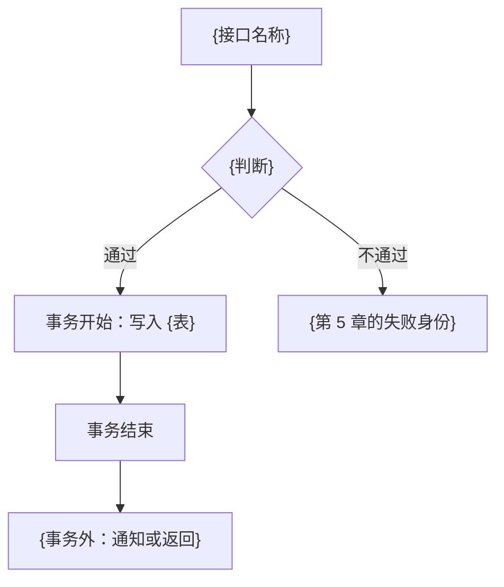

# 需求显化

把需求原文写成一份显化稿：产品原意、范围、规则、表、领域、出入参、接口、流程和事务切入点，供后续拆解使用。

基于第一性原理和对抗性审查，用白话写。信息不足标 `⚠️ 待确认`，不臆造、不直接假定。列出备选后，标明本次采用的假设再写完全文；未观察到的规模、并发、耗时不得写成已确认事实。

---

## 1. 产出

一份显化稿。调用方指定了路径就用该路径；未指定时写入 `_feat-doc/{YYYYMMDD}_{需求名称}/spec.md`。目录不存在则先创建，并在回复里给出路径。

---

## 2. 输入

**必需**：需求原文。它是产品口径的唯一来源。

同时观察目标系统里已经存在的领域、存量表、接口形态和事务做法。观察不到的项标待确认。

---

## 3. 写法

用白话写，让没看过实现的人也能核对。每条设计带理由。写完后按第 6 节自检，核对：

- 状态、重复提交、半成功是否写清
- 流程图上的写与事务切入点是否同一段
- 接口列表与流程图能否对上
- 待确认是否带采用假设

---

## 4. 分析顺序

按下列顺序写。某步不适用时，对应章节保留标题，用一句话说明原因。

### 4.0 先观察目标系统

在设计表、领域、接口、事务之前，看清已经存在的：

- 领域及其职责
- 表：表名、主键如何生成、审计列、删除语义、索引如何命名
- 外部如何触发一次动作（请求、消息、定时、批处理、界面）
- 事务从哪里开启，跨领域的写如何收场

后续章节沿用观察到的形式和名字。

### 4.1 澄清

通读原文，标出还不能据此做设计的点：

- **边界**：范围是全部还是一项，做到哪一步算完成
- **状态**：哪些状态下允许该动作，重复做会发生什么
- **失败**：前提不满足时，调用方看到什么
- **规则**：状态改变之后，相关的缓存、通知、下游是否立刻一致

每条写出备选和本次采用的假设，汇总到稿最前面的待确认章。原文无歧义时该章写「无」。

### 4.2 背景、目标、范围、非目标

- 背景：为何现在要做，现状哪里不够
- 目标：做成之后，业务上可以确认的结果
- 范围：本次要交付的能力
- 非目标：相关、但本次明确不做的事（写具体）

### 4.3 规则、场景、失败

- **规则**：不依赖界面文案也能复述的业务约束
- **场景**：触发条件、处理过程、期望结果
- **预期失败**：每条写出触发条件和一个稳定的失败身份（人读的句子可以变，身份不变）。技术故障收成一个统一失败身份。多语言只按失败身份取文案。

### 4.4 表设计

先判断这次有没有表变动。新建表、改列、改约束、改索引都算变动。

**没有变动**：本章写「本需求不涉及表变动」。

**有变动**：只写结构有变化的表。

1. **列出变动的表**，标明新建或改已有表。只是另一行上的属性，做成列。
2. **对照存量表**，记下实际在用的口径：表名、主键、审计列、删除、枚举、索引命名。新表和改列与之对齐。看不到时这些口径逐项标待确认，列和约束仍然写出来。
3. **设计列、约束和表间关系**。每列写清含义、是否可空、默认值、唯一性；关联落在哪一列；删除或更新时如何处理。能算出的事实不重复存列；查询路径要求冗余时，写明由谁在何时维护。
4. **由查询决定索引**。先列出过滤、排序、分页，再为这些列设计索引。唯一性用唯一索引。
5. **输出 DDL 和表意图**。新建给 `CREATE TABLE`，改已有表给 `ALTER` 或等价语句，方言用存量表已经在用的那种。每张表后面用几句话写：存什么、服务哪个场景、和哪些表关联、唯一性和删除各表达什么。
6. **查询–索引对照**（变动的表本次会被查询时）：

   | 查询场景 | 过滤·排序·分页 | 依赖索引（已有或拟建） | 备注 |
   | -------- | -------------- | ---------------------- | ---- |
   | {谁在什么情况下读} | {条件、排序、分页} | {索引名或列组合} | {索引用不上或条件不清} |

   条件不清时标待确认，并写下采用的假设。

7. **改已有表**时再附变更清单：

   | 表 | 列或索引 | 变更 | 说明 |
   | -- | -------- | ---- | ---- |
   | {表名} | {列名或索引名} | 新增 / 修改 / 删除 | {为何改} |

列名和索引名与后面的表数据结构保持同一说法。某个查询或写入明显需要并发约定时，注明「可并发 / 须串行 / 流程级互斥 / ⚠️ 待确认」之一。

### 4.5 领域

领域是一块业务职责：同一领域里的对象和规则放在一起讲得清。

1. 抽出核心业务对象。
2. 对照 4.0 里已经看到的领域。
3. 这些对象和规则本来就由某个已有领域负责，就归入该领域；一个都套不上，才新建，并写清已有领域为什么装不下。拿不准时标待确认，同时写下本次采用的归属。

**新建领域**：

| 项 | 写什么 |
| -- | ------ |
| 名称 | 业务名。目标系统已有命名习惯时一并给出标识 |
| 职责 | 管哪些对象、哪些规则 |
| 包含 | 这次以及本领域应拥有的能力 |
| 不包含 | 容易算进来、但属于别的领域的事 |
| 依赖 | 要调用的其他领域，只允许单向 |

**归入已有领域**：归属哪个、为什么是它、要不要扩大职责、容易混淆的领域为什么不是。

### 4.6 表数据结构、领域出入参、接口出入参

三样分开写。调用顺序：接口入参 → 领域入参 → 表数据结构；返回时反过来。某一跳两边字段一致时，写明「与上一层相同」，仍然分节列出。

**表数据结构**。只给本次新建或改动的表写。表无变动时写「无表变动，不新增表数据结构」。

| 表数据结构 | 字段 | 含义 | 对应列 |
| ----- | ---- | ---- | ------ |
| {表数据结构名} | {字段} | {含义；有状态时写出取值} | {4.4 的列} |

表数据结构只含这张表的列。

**领域出入参**。本次每个领域动作一组。

入参：

| 领域动作 | 字段 | 必填 | 含义 | 校验 |
| -------- | ---- | ---- | ---- | ---- |
| {动作} | {字段} | 是 / 否 | {业务含义} | {状态、唯一性、范围} |

出参：

| 领域动作 | 字段 | 含义 | 来自哪个表数据结构字段 |
| -------- | ---- | ---- | ------------------- |
| {动作} | {字段} | {领域返回的内容} | {表数据结构.字段；不是表字段则写「无」} |

若 4.4 写了查询–索引对照，领域入参的查询条件与之同一组字段。业务校验失败用第 5 章的失败身份。需求关心「读到的是不是最新」时写缓存，并写明以表为准还是以缓存为准。

**接口出入参**。4.7 里每个接口一组，接口名与列表一致。

入参：

| 接口 | 字段 | 必填 | 含义 | 校验 | 对应领域入参 |
| ---- | ---- | ---- | ---- | ---- | ------------ |
| {接口} | {字段} | 是 / 否 | {调用方传入的内容} | {空、格式} | {领域动作.字段；由接口补上的写明来源} |

出参：

| 接口 | 字段 | 含义 | 对应领域出参 |
| ---- | ---- | ---- | ------------ |
| {接口} | {字段} | {调用方拿到的内容} | {领域动作.字段；接口额外组装的写「无」} |

接口入参做格式和必填校验。状态、唯一性等业务校验留在领域入参。

### 4.7 接口列表

列出本次新增、修改，或沿用并被这次流程调用到的接口。

| 接口名称 | 作用 | uri | 变更 | 是否幂等 |
| -------- | ---- | --- | ---- | -------- |
| {目标系统里的接口名} | {这个接口做什么} | {路径；还没有则 ⚠️ 待确认} | 新增 / 修改 / 沿用 | 是 / 否 |

名称和 uri 用目标系统已经在用的名字。重复调用和调用一次的业务结果相同则幂等为「是」。入参出参见 4.6，预期失败指向第 5 章。

只改已有行为时，列出被波及的已有接口，变更填「修改」或「沿用」。

### 4.8 业务流程

每个主场景一张 mermaid `flowchart`。节点用业务动作，并标上 4.7 的接口名。一条主路径加上关键分支：成功、规则里已经出现的失败、重复做会怎样。

写表的那一段标出事务从哪一个节点开始、到哪一个节点结束。远程调用、缓存、通知、把结果返回调用方画在这段之外。



多个主场景就多画几张。图中出现的接口都能在 4.7 找到。

### 4.9 事务切入点

对着 4.8 每一张含写表的流程图写明事务从哪里开始。没有写表时写「本需求无事务切入点」。

| 流程 | 切入点 | 同一次提交中的表写入 | 事务外的动作 | 半成功时调用方看到什么 |
| ---- | ------ | -------------------- | ------------ | ---------------------- |
| {对应哪张流程图} | {哪个接口的哪一步} | {哪些表、写入什么} | {远程调用、缓存、通知、返回} | {没有半成功则写「同一次提交」} |

一条流程里有多处写表时，写清是同一次提交还是各自提交。本步写切入点和提交范围。

---

## 5. 显化稿

章节号 0–13，不适用的章节保留标题并说明原因。

```markdown
# 需求显化：{需求名称}

| 字段 | 值 |
| ---- | -- |
| 生成时间 | {日期} |
| 原始需求来源 | {原文或引用} |
| 文档编号 | {调用方未指定则可省略} |
| 优先级 | {P0 / P1 / P2 / P3，未知则待确认} |
| 目标版本 | {迭代或日期，未知则待确认} |
| 影响范围 | {领域、接口、表} |
| 关联表 | {表名，或无} |
| 关联接口 | {接口名} |

## 0. 文档定位
本文回答产品原意、范围、规则和设计决策，供后续拆解使用。

## 1. 背景与目标
## 2. 范围与非目标
## 3. 待确认项与采用假设
## 4. 规则与关键场景
## 5. 关键失败路径
## 6. 表设计
## 7. 领域
## 8. 表数据结构、领域出入参与接口出入参
## 9. 接口列表
## 10. 业务流程
## 11. 事务切入点
## 12. 风险、依赖与开放问题
## 13. 给后续拆解的摘要
```

各章按第 4 节对应小节写。

第 12 章：可能让实现走偏的风险、依赖的外部条件、仍未关闭的问题。

第 13 章四行：

- 变更目标：一句话
- 主要影响面：领域、接口、表
- 必须守住的约束：领域职责、兼容、非目标
- 适合继续拆开的方向：按领域、按接口或按场景，选一种并说明为何这样切

范围、规则、表或领域变了，先改这份稿，再让后续流程跟上。

---

## 6. 落盘前自检

- [ ] 待确认集中在第 3 章，每条有备选和采用假设
- [ ] 范围与非目标具体
- [ ] 规则、场景、失败能对上后文的接口和流程图
- [ ] 表无变动已写明；有变动则只含变动表，新建有 DDL，改已有表有变更清单，每张有表意图，有查询则有对照
- [ ] 主键、审计列、删除语义、命名已对齐存量表，或已标待确认
- [ ] 未观察到的内容已标待确认，没有臆造或直接写成已确认事实
- [ ] 领域已归入已有或新建；新建写了不包含项；依赖单向
- [ ] 表数据结构、领域出入参、接口出入参分节写出，并能互相对上
- [ ] 接口列表覆盖新增、修改、沿用，每条有名称、作用、uri、变更、是否幂等
- [ ] 每个主场景有流程图；图中接口能在列表里找到；写表段落标了事务起止
- [ ] 含写表的流程有事务切入点：哪一步、同一次提交的表、事务外动作、半成功时的结果
- [ ] 第 13 章四行可以独立阅读
