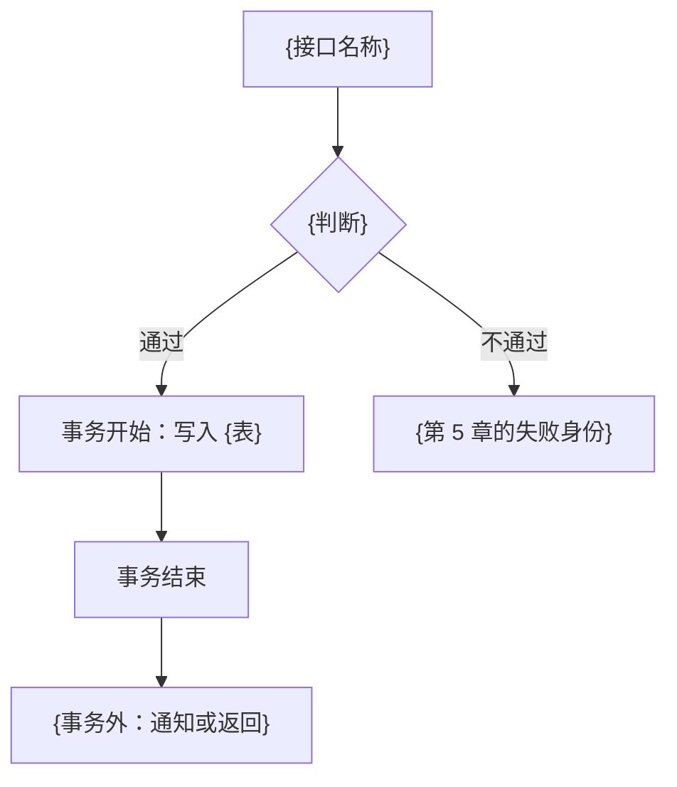

# 需求显化

---

## 0. 基础信息

- **Skill 名称**: 需求显化
- **描述**: 把一段模糊的需求彻底显化，防止业务语义失真和业务偏离。产出一份单文档显化稿。

---

## 1. 目标

- **目的**：把一段模糊的需求彻底显化，防止业务语义失真和业务偏离。
- **做什么**：把需求原文写成一份显化稿。
- **不做什么**：
  - 不写实现代码
  - 不拆任务、不写验收清单、不记录执行状态、证据或自动验收结果
  - 不产出视觉稿
  - 不制定压测、部署和运维方案

---

## 2. 输入

**必需**：需求原文。自然语言、用户故事、功能清单都可以。原文是产品口径的唯一来源。仓库里的技术规范、历史实现和本 Skill 都不是产品需求。

另外两项以调用方和目标系统为准：

- 显化稿的保存路径与文件名。调用方或所执行的 command 已指定时，按指定写入。都未指定时，在当前工作区写入 `spec.md`，并在回复里给出完整路径。
- 目标系统里已经存在的领域、存量表、接口形态、事务做法。分析时去观察，观察不到就标 `⚠️ 待确认`。

信息不足时：标出待确认项，列出备选，采用其中最合理的一条继续写完全文。不因待确认而停笔，也不把未观察到的规模、并发、耗时写成已确认事实。

---

## 3. 工作立场

写完全文之前，用白话让没看过实现的人也能核对。每条设计写明理由。写完后按第 7 节自检，专门找这几类洞：

- 漏掉的状态、重复提交、半成功
- 流程图上的写，和事务切入点对不上
- 接口列表里的接口，在流程图里找不到
- 把推测写成事实

---

## 4. 分析顺序

按下列顺序写。某步的跳过条件成立时，在对应章节用一句话说明为何不涉及，保留章节标题。

### 4.0 先观察目标系统

在设计表、领域、接口、事务之前，查看目标系统里已经存在的：

- 已有哪些领域，各自负责什么
- 已有哪些表：表名、主键如何生成、审计列、删除语义、索引如何命名
- 外部如何触发一次动作（请求、消息、定时、批处理、界面）
- 事务从哪里开启，跨领域的写现在如何收场

后续章节沿用观察到的形式和名字。观察不到的项进入待确认。

### 4.1 澄清

通读原文，标出还不能据此做设计的点，至少覆盖：

- **边界**：范围是全部还是一项，做到哪一步算完成
- **状态**：哪些状态下允许该动作，重复做会发生什么
- **失败**：前提不满足时，调用方看到什么
- **规则**：状态改变之后，相关的缓存、通知、下游是否立刻一致

每条用 `⚠️ 待确认` 写出备选假设和本次采用的假设。全部汇总到显化稿最前面的待确认章。原文已经无歧义时，该章写「无」。

### 4.2 背景、目标、范围、非目标

- 背景：为何现在要做，现状哪里不够
- 目标：做成之后，业务上可以确认的结果
- 范围：本次要交付的能力
- 非目标：相关、但本次明确不做的事

非目标写具体。空泛的「不做无关改动」不算非目标。

### 4.3 规则、场景、异常

- **规则**：不依赖界面文案也能复述的业务约束
- **场景**：触发条件、处理过程、期望结果
- **异常**：预期内的失败。每条写出触发条件，以及一个稳定的失败身份（调用方可以据此分支；人读的句子可以变，身份不变）。技术故障收成一个统一的失败身份，不把内部细节写成对外契约。若调用方要做多语言，只按失败身份取文案。

### 4.4 表设计

先判断这次有没有表变动。新建表、改列、改约束、改索引，都算变动。只读写已有表、结构不动，不算。

**没有变动**：本章只写「本需求不涉及表变动」，到此为止。不列候选表，不写 DDL，不写查询–索引对照。

**有变动**：只写发生变动的表，按下面顺序做完。

1. **列出变动的表**  
   只列结构有变化的表，标明新建或改已有表。只是另一行上的属性，做成列，不另起一张表。结构不动的已有表不列入。

2. **对照存量表**  
   先看目标系统里已经存在的表，记下它实际在用的口径：表名、主键如何生成、审计列有哪些、删除如何表达、枚举如何落列、索引如何命名。新表和改列与这些口径对齐。看不到存量表时，这些口径逐项标 `⚠️ 待确认`，列和约束仍然写出来。

3. **设计列、约束和表间关系**  
   每列写清含义、是否可空、默认值、唯一性。表与表的关联落在哪一列，以及删除或更新时这一列如何处理。能由其他列算出的事实不重复存列；查询路径要求冗余时，写明冗余由谁在何时维护。

4. **由查询决定索引**  
   先列出这次会怎么查：过滤、排序、分页。再为这些定位和排序列设计索引。唯一性用唯一索引表达。

5. **输出 DDL 和表意图**  
   每张新建的表给一段 `CREATE TABLE`；结构有变化的已有表给 `ALTER` 或与之等价的变更语句。方言用目标系统存量表已经在用的那种。没有既定方言时用通用 `CREATE TABLE`，并注明方言待确认。  
   每张表后面用几句话写表意图：存什么、服务哪个场景、和哪些表关联、唯一性和删除各表达什么。

6. **查询–索引对照**  
   变动的表本次会被查询时，附上对照。没有查询则不写这张表。

   | 查询场景 | 过滤·排序·分页 | 依赖索引（已有或拟建） | 备注 |
   | -------- | -------------- | ---------------------- | ---- |
   | {谁在什么情况下读} | {条件、排序、分页方式} | {索引名或列组合} | {索引用不上或条件不清时写在这里} |

   条件不清时标 `⚠️ 待确认`，并写下本次采用的假设。

7. **改已有表时**  
   除 DDL 或 `ALTER` 外，再附变更清单：

   | 表 | 列或索引 | 变更 | 说明 |
   | -- | -------- | ---- | ---- |
   | {表名} | {列名或索引名} | 新增 / 修改 / 删除 | {为何改} |

列名和索引名与后面的 Model 保持同一说法。

某个查询或写入明显需要并发约定时，在对应行注明「可并发 / 须串行 / 流程级互斥 / ⚠️ 待确认」之一。看不出需要时不填。未观察到的数据量和并发不写成已确认事实。

### 4.5 领域

判断这次需求落在哪个领域。领域是一块业务职责：同一领域里的对象和规则放在一起讲得清，换一个领域就不再由它负责。

1. 从需求里抽出核心业务对象。
2. 对照 4.0 里已经看到的领域。
3. 这些对象和规则本来就由某个已有领域负责，就归入该领域。一个都套不上，才新建领域，并写清已有领域为什么装不下。拿不准时标 `⚠️ 待确认`，同时写下本次采用的归属。

**新建领域**写这几项：

| 项 | 写什么 |
| -- | ------ |
| 名称 | 业务名。目标系统已有命名习惯时一并给出标识 |
| 职责 | 管哪些对象、哪些规则 |
| 包含 | 这次以及本领域应拥有的能力 |
| 不包含 | 容易算进来、但属于别的领域的事 |
| 依赖 | 要调用的其他领域。只允许单向依赖，不成环 |

**归入已有领域**写这几项：归属哪个领域、为什么是它、要不要把它的职责扩大、容易混淆的领域为什么不是。

### 4.6 Model、领域出入参、接口出入参

这三样分开写，不合并成一张字段表。

| | 是什么 | 谁使用 |
| -- | ------ | ------ |
| 表 Model | 一张表在程序里的一行。字段对应 4.4 的列 | 读写这张表时 |
| 领域出入参 | 领域方法收到的入参、返回的出参 | 领域内部，以及其他领域调用它时 |
| 接口出入参 | 对外接口收到的入参、返回的出参 | 接口的调用方 |

调用顺序是：接口入参 → 领域入参 → 表 Model；返回时反过来：表 Model → 领域出参 → 接口出参。某一跳两边字段一致时，写明「与上一层相同」，仍然分节列出，不省掉这一层。

**表 Model**。只给本次新建或改动的表写 Model。表无变动时，这一节写「无表变动，不新增 Model」。

| Model | 字段 | 含义 | 对应列 |
| ----- | ---- | ---- | ------ |
| {表的 Model 名} | {字段} | {含义；有状态时写出取值} | {4.4 的列} |

Model 只含这张表的列，不含接口协议字段，也不含只在某次调用里出现的过滤条件。

**领域出入参**。本次每个领域动作一组。动作名用领域里的说法。

入参：

| 领域动作 | 字段 | 必填 | 含义 | 校验 |
| -------- | ---- | ---- | ---- | ---- |
| {动作} | {字段} | 是 / 否 | {业务含义} | {业务规则：状态、唯一性、范围} |

出参：

| 领域动作 | 字段 | 含义 | 来自哪个 Model 字段 |
| -------- | ---- | ---- | ------------------- |
| {动作} | {字段} | {领域返回的内容} | {Model.字段；不是表字段则写「无」} |

若 4.4 写了查询–索引对照，领域入参里的查询条件与之同一组字段。业务校验失败用第 5 章的失败身份。缓存只有在需求关心「读到的是不是最新」时才写，并写明以表里的行为准，还是以缓存为准。

**接口出入参**。4.7 里每个接口一组。接口名与列表中的接口名称相同。

入参：

| 接口 | 字段 | 必填 | 含义 | 校验 | 对应领域入参 |
| ---- | ---- | ---- | ---- | ---- | ------------ |
| {接口} | {字段} | 是 / 否 | {调用方传入的内容} | {空、格式} | {领域动作.字段；调用方不传、由接口补上的写明来源} |

出参：

| 接口 | 字段 | 含义 | 对应领域出参 |
| ---- | ---- | ---- | ------------ |
| {接口} | {字段} | {调用方拿到的内容} | {领域动作.字段；接口额外组装的写「无」} |

接口入参做格式和必填校验。状态、唯一性等业务校验留在领域入参那一层。

### 4.7 接口列表

列出本次需求会新增、修改，或沿用并被这次流程调用到的接口。每条写五点：接口名称、作用、uri、变更、是否幂等。

| 接口名称 | 作用 | uri | 变更 | 是否幂等 |
| -------- | ---- | --- | ---- | -------- |
| {目标系统里的接口名} | {这个接口做什么} | {路径；还没有则 ⚠️ 待确认} | 新增 / 修改 / 沿用 | 是 / 否 |

接口名称和 uri 用目标系统已经在用的名字。uri 还没有则标 `⚠️ 待确认`。重复调用和调用一次的业务结果相同，是否幂等填「是」，否则填「否」。入参和出参见 4.6，预期失败指向第 5 章，不写进这张表。

本次不新增接口、只改已有行为时，列出被波及的已有接口，变更填「修改」或「沿用」。

### 4.8 业务流程

每个主场景画一张大致流程图，用 mermaid `flowchart`。节点用业务动作，并标上 4.7 里的接口名。一条主路径加上关键分支即可：成功、规则里已经出现的失败、重复做会怎样。

写表的那一段在图上标出事务从哪一个节点开始、到哪一个节点结束。远程调用、缓存、通知、把结果返回调用方，画在这段之外。

不展开到每一层内部的对象转换，不另附逐步调用表。



多个主场景就多画几张，每张注明对应哪个场景。图中出现的接口都能在 4.7 的列表里找到。

### 4.9 事务切入点

对着 4.8 的每一张含写表动作的流程图，写明事务从哪里开始。没有写表时，本章写「本需求无事务切入点」。

| 流程 | 切入点 | 同一次提交中的表写入 | 事务外的动作 | 半成功时调用方看到什么 |
| ---- | ------ | -------------------- | ------------ | ---------------------- |
| {对应哪张流程图} | {哪个接口的哪一步} | {哪些表、写入什么} | {远程调用、缓存、通知、返回} | {没有半成功则写「同一次提交」} |

一条流程里有多处写表时，写清是从同一个切入点开启一次提交，还是每处各自提交。不能放进同一次提交的调用，放在「事务外」，并写明前面已经提交的部分会留下什么。

本步只确定切入点和提交范围，不写闭包内部的逐步调用，不写补偿地址或幂等组件的名字。

---

## 5. 显化稿

### 5.1 唯一产物

只写一份显化稿。不另写任务清单、验收清单，也不默认编需求编号、任务编号、验收编号。调用方明确要求编号时才加。

稿内不出现：执行状态、当前阶段、验证结论、证据位置、自动验收命令。

### 5.2 文档骨架

章节号保持 0–13，不跳号。不适用的章节保留标题，用一句话说明原因。

```markdown
# 需求显化：{需求名称}

| 字段 | 值 |
| ---- | -- |
| 生成时间 | {日期} |
| 原始需求来源 | {原文或引用} |
| 文档编号 | {调用方未指定则可省略} |
| 优先级 | {P0 / P1 / P2 / P3，未知则待确认} |
| 目标版本 | {迭代或日期，未知则待确认} |
| 影响范围 | {领域、接口、表} |
| 关联表 | {表名，或无} |
| 关联接口 | {接口名} |

## 0. 文档定位
本文只回答产品原意、范围、规则和设计决策，供后续拆解使用。不记录任务与执行结果。

## 1. 背景与目标
## 2. 范围与非目标
## 3. 待确认项与采用假设
## 4. 规则与关键场景
## 5. 关键异常路径
## 6. 表设计
## 7. 领域
## 8. Model、领域出入参与接口出入参
## 9. 接口列表
## 10. 业务流程
## 11. 事务切入点
## 12. 风险、依赖与开放问题
## 13. 给后续拆解的摘要
```

各章正文按第 4 节对应小节的要求写，不在骨架之外另起一套章节。

第 12 章写：可能让实现走偏的风险、依赖的外部条件、仍未关闭的问题。

第 13 章只用四行：

- 变更目标：一句话
- 主要影响面：领域、接口、表
- 必须守住的约束：领域职责、兼容、非目标
- 适合继续拆开的方向：按领域、按接口或按场景，选一种并说明为何这样切

### 5.3 和后续工作的关系

显化稿是后续拆解的输入。范围、规则、表结构或领域划分变了，先改显化稿，再让后续流程跟上。后续流程里的任务状态和验证结果不写回这份稿。

最小可用的一份稿，至少写清：背景、目标、范围、非目标、待确认项；表无变动则写明不涉及表变动；表有变动则按 4.4 写出变动表的 DDL 或变更清单、表意图，有查询再附查询–索引对照；归入哪个领域；表 Model、领域出入参、接口出入参三者分开；接口列表、每条主场景的流程图、事务切入点；最后带上第 13 章摘要。

---

## 6. 约束

- 落盘路径以调用方为准。未指定时写入当前工作区的 `spec.md`，并在回复中说明路径。不只在对话里输出。
- 产品口径只来自需求原文。与原文冲突的实现习惯，标出来交给确认，不静默改写需求。
- 表无变动时，显化稿写明不涉及表变动，不附 DDL 和查询–索引对照。表有变动时，只写变动的表：新建有 DDL，改已有表有变更清单，每张有表意图；这些表有查询时有查询–索引对照。
- 主键、审计列、删除语义、表名和索引名与目标系统存量表对齐。存量表里看不到的口径标 `⚠️ 待确认`。
- 接口列表覆盖本次新增、修改和沿用的接口，每条有名称、作用、uri、变更、是否幂等。
- 每个主场景有一张大致业务流程图。图上的接口都能在接口列表里找到，写表的段落标出事务从哪一节点开始、到哪一节点结束。
- 每条含写表的流程有事务切入点：从哪个接口的哪一步开始，同一次提交写哪些表，哪些动作在事务外，半成功时调用方看到什么。
- 预期失败都有稳定身份。技术故障使用统一失败身份。
- 不确定处使用 `⚠️ 待确认`，并写上本次采用的假设。

---

## 7. 完成前自检

落盘前逐项核对。不适用的项在稿内已有一句话说明。

- [ ] 待确认项集中在第 3 章，每条有备选和本次采用的假设
- [ ] 范围与非目标都具体
- [ ] 规则、场景、异常能对应到后文的接口和流程图
- [ ] 表无变动时已写明不涉及表变动，且没有 DDL 和查询–索引对照
- [ ] 表有变动时：只包含变动的表；新建有 DDL，改已有表有变更清单；每张有表意图；这些表有查询时有查询–索引对照
- [ ] 主键、审计列、删除语义、命名已对齐观察到的存量表，或已标待确认
- [ ] 未把未观察到的数据量或并发写成事实；需要并发约定的查询或写入已选择一种说法
- [ ] 领域已写明归入已有领域或新建；新建写了不包含项；依赖不成环
- [ ] 表 Model、领域出入参、接口出入参分节写出；Model 字段对应表列；接口出入参写明对应哪一项领域出入参；接口名与接口列表一致
- [ ] 接口列表覆盖新增、修改、沿用的接口，每条都有名称、作用、uri、变更、是否幂等
- [ ] 每个主场景有一张大致流程图；图中的接口能在接口列表里找到
- [ ] 写表的流程标出了事务从哪一节点开始、到哪一节点结束
- [ ] 事务切入点写明：哪个接口的哪一步、同一次提交中的表、事务外的动作、半成功时的结果；无写表则已声明无事务切入点
- [ ] 稿中没有任务、验收、证据、执行状态
- [ ] 第 13 章四行摘要可以独立阅读
